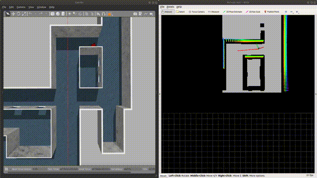

[toc]

# ROS 2 (Humble) 适配说明

本项目原本是基于 ROS 1（melodic/noetic）的，现已适配 **ROS 2 Humble**。
ROS 1 的源码仍保留在仓库中，但不再参与 ROS 2 的编译（见文末说明）。

## 编译

```bash
cd ~/ego_ground_ws            # 包含 src/ego-planner-for-ground-robot 的工作空间
source /opt/ros/humble/setup.bash
colcon build
source install/setup.bash
```

说明：

* **qpOASES 不再需要手动安装**。如果系统中找不到已安装的 qpOASES，编译
  `mpc_controller` 时会自动编译 `ego-planner/qpOASES` 中的源码（加 `-fPIC`，
  静态链接进 `libmpc_controller.so`）。如果你已经装到 `/usr/local`，会优先使用系统版本。
* `patchwork` 需要 `libboost-dev`、`libpcl-dev`、OpenCV；`plan_env` 需要
  `libopencv-dev`。桌面版系统一般已自带。

## 运行

```bash
ros2 launch ego_planner run_in_sim.launch.py \
    odom_topic:=/state_estimation pointcloud_topic:=/registered_scan
```

该命令会启动 4 个节点：`ego_planner_node`（FSM + 局部地图）、`traj_server`
（MPC 轨迹跟踪，输出 `/cmd_vel`）、patchwork 的 `ground_segmentation`
（`/pointcloud_scan` → `/benchmark/{cloud,P,N}`）以及 RViz2。常用参数：

| 参数 | 默认值 | 含义 |
| --- | --- | --- |
| `odom_topic` | `/state_estimation` | 机器人状态（nav_msgs/Odometry） |
| `pointcloud_topic` | `/registered_scan` | 建图 / 地面分割用的 PointCloud2 |
| `goal_topic` | `/goal_pose` | 目标点（RViz2 的 “2D Goal Pose”） |
| `map_size_x/y/z` | `300/300/4` | 地图缓冲大小，小车可改小（如 `40/40/3`），内存按 `x*y*z/res³` 个体素估算 |
| `max_vel`、`max_acc` | `1.5`、`3.0` | 规划与优化的速度 / 加速度上限 |
| `planning_horizon` | `10.5` | 重规划视野，取传感器视野的 1.5 倍左右 |
| `flight_type` | `1` | `1`：RViz 给目标；`2`：使用配置文件里的固定航点 |
| `rviz` | `true` | 是否启动 RViz2 |

在 RViz2 中选择 **2D Goal Pose** 工具点击目标位置即可，规划器会持续重规划，
`traj_server` 在 `/cmd_vel` 上发布速度指令。若要用自己的节点发送目标点，
把 `goal_topic` 改成对应话题即可（消息类型 `geometry_msgs/PoseStamped`）。

其他入口：

```bash
ros2 launch patchwork ground_segmentation.launch.py pointcloud_topic:=/registered_scan
ros2 launch ego_planner rviz.launch.py
```

## 适配内容

* `catkin` → `ament_cmake`，`package.xml` 改为 format 3；`ros/ros.h` → `rclcpp`；
  `ros::NodeHandle/Publisher/Subscriber/Timer` → `rclcpp` 对应类型；
  `ROS_*` 宏 → `RCLCPP_*`。
* 消息用 `rosidl` 生成：`ego_planner/msg/Bspline.msg`、`DataDisp.msg`（头部要写成
  `std_msgs/Header`，时间字段写成 `builtin_interfaces/Time`）。patchwork 的
  `node.msg`/`ground_estimate.msg` 改名为 `Node.msg`/`GroundEstimate.msg`
  （ROS 2 要求消息名大写开头）。
* `tf` → `tf2`（`tf2::Quaternion`、`Matrix3x3::getRPY`）；`nav_msgs::Path` 等 →
  `nav_msgs::msg::Path`；`pcl_conversions` 按 header-only 使用；`message_filters`
  使用 ROS 2 接口。
* 参数名用“点”代替“斜杠”（如 `grid_map.resolution`），参数值放在
  [config/ego_planner.yaml](ego-planner/planner/plan_manage/config/ego_planner.yaml)
  （替代 `launch/advanced_param.xml`）和
  [config/ground_segmentation.yaml](ego-planner/patchwork/config/ground_segmentation.yaml)
  （替代 `params_ouster128.yaml`）。数值参数写 `2` 或 `2.0` 都可以，节点会自动
  做类型转换。
* launch 文件改为 Python（`run_in_sim.launch.py`、`rviz.launch.py`、
  `ground_segmentation.launch.py`）；ROS 1 的 launch/参数/rviz 文件保留在
  `*/launch/ros1/`、`*/config/ros1/` 目录下备查。
* 地图的点云订阅使用 best effort QoS，兼容 best effort 发布的雷达驱动。
* 顺带修复了在 ROS 2 下才暴露的问题：`EGOReplanFSM::trigger_` 等标志位原本未
  初始化（偶发导致 FSM 初始状态异常）；`gradient_descent_optimizer` 中 `1e10`
  赋给 `int` 的窄化转换；以及时间戳来源不一致导致 `rclcpp::Time` 相减抛异常。

## 尚未适配的部分

* `autonomous_exploration_development_environment/`（CMU 仿真环境：Gazebo classic
  插件、ROS 1 版 RViz 插件、手柄驱动）仍是 ROS 1 代码，已通过 `COLCON_IGNORE`
  文件排除在 colcon 编译之外（`ego-planner/qpOASES` 同理）。如果以后移植了仿真
  环境，删掉该 `COLCON_IGNORE` 即可。
* patchwork 中只编译了地面分割节点 `ground_segmentation`
  （来自 `nodes/offline_own_data.cpp`）。KITTI/legoloam 的评测脚本
  （`offline_kitti.cpp`、`ros_kitti.cpp`、`pub_for_legoloam.cpp`）仍使用 ROS 1
  接口与旧消息名，未参与编译。

在真机上使用时，只需要给规划器提供两路输入：里程计（默认
`/state_estimation`）和配准后的点云（默认 `/registered_scan`），其余的地面分割、
局部地图、规划、MPC 都已包含在本工作空间中。

# 点到点小车仿真（ROS 2 闭环）

新增的 `ego_ground_sim` 包把 Gazebo 与规划器连成闭环，不再依赖仍是 ROS 1 的 CMU
仿真环境：包含前进＋转向（差速）底盘、三维雷达、里程计/TF，以及位于底盘之前的
安全看门狗。

```bash
ros2 launch ego_ground_sim sim_ego_planner.launch.py                         # Gazebo 界面 + RViz2
ros2 launch ego_ground_sim sim_ego_planner.launch.py gui:=false rviz:=false  # 无界面
```

然后在 RViz2 里用 **2D Goal Pose** 工具给目标点（话题 `/goal_pose`）。数据流：

```
目标点 -> ego_planner_node -> /planning/bspline -> traj_server --+
                                                                 v
                              /cmd_vel -> cmd_vel_safety -> /cmd_vel_safe -> 轮子
三维雷达 -> /scan_3d -> point_cloud_transformer -> /registered_scan -> patchwork
                                        -> /benchmark/{P,N} -> 局部地图 -> 规划器
底盘里程计 -> /state_estimation -> 规划器 + MPC + 看门狗
```

包内说明见 [ego_ground_sim/README.md](ego_ground_sim/README.md)。有两点需要特别注意：

* 建图模块会把**每一个测到的点都当作占据**，所以如果把原始点云直接送进去，地面本身
  就会被当成障碍物（机器人自己也就“在障碍里”），每次规划都会失败。因此启动文件默认把
  `/grid_map/cloud` 接到地面分割后的点云（`mapping_cloud_topic:=/benchmark/N`）。
  只有当你的雷达看不到地面时，才改用 `mapping_cloud_topic:=/registered_scan`。
* 所有节点都使用 `use_sim_time:=true`，定时器跟随仿真时钟。注意独立的
  `rclcpp::Clock` **不会**订阅 `/clock`，把它和节点时钟混用会让规划器的碰撞检查循环
  走 1e9 秒的“时间”（真实 bug，本工作空间已修复：见 `EGOPlannerManager::clock_` 与
  `EGOReplanFSM::checkCollisionCallback` 中的保护）。

## 实测结果（2026-10-11，无界面运行）

```bash
ros2 launch ego_ground_sim sim_ego_planner.launch.py gui:=false rviz:=false
python3 install/ego_ground_sim/share/ego_ground_sim/scripts/closed_loop_check.py 6.0 4.5
```

| 检查项 | 结果 |
| --- | --- |
| 小车确实在动（物理引擎按 `/cmd_vel_safe` 驱动） | 实走 22.41 m，直线 17.20 m → 走了绕行路线 |
| 规划器收到输入 | 非地面点 778、`/map_2d` 更新 402 次、里程计 50 Hz |
| 目标点产生轨迹 | `/planning/bspline` 21 条，规划成功 34 次，失败 0 次 |
| MPC 驱动 | 最高速度 1.13 m/s（`MPC/v_max` = 1.2） |
| 绕障 | 与 5 个障碍物的最小间距 +0.94 / +1.64 / +0.67 / +1.49 / +0.90 m，未压到任何障碍 |
| 到点停车 | 到点误差 0.61 m，`/cmd_vel_safe` = 0，之后位置漂移 0.000 m |
| 数据超时停车 | 指令源停止后 0.5 s 内 `/cmd_vel_safe` = 0，漂移 0.000 m |
| 失败/非法指令 | 速度指令为 NaN 时 `/cmd_vel_safe` = 0 |

说明：每次收到新目标后，FSM 会先让小车转向规划轨迹的初始方向（`ADJUST_POSE`），这是
原 ROS 1 代码的行为；取决于初始多项式，这一转向有时会比较大。

## 在 CMU indoor 走廊场景上运行

原 README 里演示用的那张场景图就在仓库里
（`autonomous_exploration_development_environment/src/vehicle_simulator/mesh/indoor`，
mesh + 贴图 + 预览点云，约 129 × 99 × 3.9 m）。`ego_ground_sim` 已把它作为
Gazebo 模型安装，因此 ROS 2 下可以直接用：

```bash
ros2 launch ego_ground_sim sim_cmu_indoor.launch.py
ros2 launch ego_ground_sim sim_cmu_indoor.launch.py gui:=false rviz:=false   # 无界面
```

默认起点在演示图 `imag/ego_example.gif` 中红色机器人附近，即长方形围挡上方的通道。
当前 `map` 坐标为 **`(-31.3, -23.4)`**，对应 CMU 原始坐标 `(31.5, -3.0)`；
车头朝 `-Y` 方向（`spawn_yaw=-π/2`），Gazebo 与 RViz 的默认视角也对准这里。
预览点云估计距墙约 1.3 m，已用碰撞模型确认车身下方及通道前后 2 m 有地板。
附近目标可以先选 `(-31.3, -25.4)`，新起点尚未做实际导航测试。
如需临时换起点，可以传入 `spawn_x:=... spawn_y:=... spawn_yaw:=...`。

下面的历史实测使用的是旧起点 `(-62.8, -20.4)`。

实测：走廊内 13 m 目标**到点误差 0.42 m**、0 次急停（速度约 0.9 m/s，大 mesh 下实时率仍
≈0.95）。只要目标在同一走廊内都能到；但 EGO 用的是 8 m 局部地图且"未知即自由"，跨房间的
远目标可能陷入局部极小（会在路口来回摆动）——多房间任务请沿路给航点，或按"导航"方案加全局
规划器。

让这个场景能跑起来必需的两处改动（真机同样相关）：

* **patchwork 必须在传感器坐标系里分割**：它的同心圆分区以点云原点为中心。现在节点会先把
  输入变换到 `sensor_frame`、再把输出变换回 `output_frame`（参数 `patchwork.sensor_frame`
  / `patchwork.output_frame`，默认都为空 = 保持原行为）。
* **`optimization.relaxed_initial_collision`（默认 false）**：当车离墙比
  `obstacles_inflation` 还近时，原代码会否掉**每一次**规划、只能不断急停；打开该开关后允许
  "轨迹起始段在膨胀带内仍然规划"（车本来就在那里），其余轨迹与 FSM 安全检查不变。

该场景专属参数在 `ego_ground_sim/config/ego_planner_indoor.yaml`（地图 140×110×2.5 m、
局部更新 8 m、膨胀 0.22 m）；挑选可达目标可用
`install/ego_ground_sim/share/ego_ground_sim/scripts/indoor_free_space.py`
（按连通性 + 通行净空给候选点，因为场景是多房间，看起来空的地方可能在墙后）。

### 常见问题：RViz 能用但 Gazebo 一闪就退

现象：`gzclient` 打开后马上消失（gzserver 与 `/clock`、`/state_estimation`、`/scan_3d`
都正常）。

原因：`GAZEBO_RESOURCE_PATH` 里没有 Gazebo 自己的 media 目录。`gazebo_ros` 的 launch
只会导出声明了 `<gazebo_ros>` 的 ROS 包路径再加上你 shell 里已有的值——如果 shell 从未
`source /usr/share/gazebo/setup.sh`，就缺失 Gazebo 的 media。而**被设置成不完整的值**会
替换掉 Gazebo 的内置默认路径，OGRE 找不到 `gazebo.material`，于是场景初始化失败、gzclient
在 `Camera` 断言处 abort：

```
[Err] [RenderEngine.cc:197] Failed to initialize scene
OGRE EXCEPTION: Cannot locate material called 'Gazebo/shadow_caster'
gzclient: ... shared_ptr<gazebo::rendering::Camera>::operator->(): Assertion `px != 0' failed.
```

本仓库的 `ego_ground_sim.launch.py` 已直接启动 gzserver/gzclient 并补齐
`GAZEBO_RESOURCE_PATH / GAZEBO_MODEL_PATH / GAZEBO_PLUGIN_PATH / OGRE_RESOURCE_PATH`，
因此不必手动 source；也可用 `gazebo_resource_path:=...` 覆盖。手动启动 Gazebo 时请先执行
`source /usr/share/gazebo/setup.sh`。

# Environment Configuration（ROS 1，历史文档）

以下内容是原 ROS 1 环境的说明，保留备查。ROS 2 Humble 的用法见上文的
“ROS 2 (Humble) 适配说明”。

## qpOASES

We use qpOASES to solve MPC，and MPC is used for trajectory tracking

qpOASES  solver installation :

```bash
cd qpOASES
mkdir build
cd build
cmake ..
sudo make
sudo make install
```

## patchwork

patchwork is used for ground segmentation. This planner accepts 3d point cloud information **Pointcloud2**. After the point cloud is segmented on the ground, the point cloud is projected to the 2d plane to construct a 2d grid map for planning.

Follow the official repository to download this package：[patchworl_github](https://github.com/LimHyungTae/patchwork)

## Simulation environment

The simulation environment uses the open source simulation environment of the CMU Robotics Institute. Users  need to install the relevant libraries and download the mesh file. We recommend to use the indoor environment to test the planner.

The environment have two versions for ros-melodic and ros-noetic. The package in this project is for ros-melodic.

[CMU-environment](https://www.cmu-exploration.com/)

# Quick Start

First , start the simulation environment :

```bash
roslaunch vehicle_simulator system_indoor.launch
```

Second, start the planner :

```bash
roslaunch ego_planner run_in_sim.launch
```

In rviz , use  **2d nav goal** to set the goal :



If you can't see the imag in this file, you can see it in the folder "imag".


# 参数调整说明

在 CMU 提供的仿真环境中，小车并不具备真实的物理引擎，能够完全按照控制指令 (线速度 v 和角速度 w) 进行运动，这会影响到 MPC 控制器的参数设定

MPC 控制器的目标函数由两部分组成：跟踪误差和运动限幅。用户可以通过下面 4 个参数进行调整：

```xml
<!-- adjust in advanced_param.xml -->
<param name="MPC/v_max" value="1.8" type="double"/>
<param name="MPC/w_max" value="1.2" type="double"/>
<param name="MPC/omega0" value="1.0" type="double"/>
<param name="MPC/omega1" value="0.5" type="double"/>
```

`MPC/v_max` 与 `MPC/w_max` 与规划时设定的最大速度与加速度有关，可以设置成略大于规划最大速度 `max_vel` 的数值

`MPC/omega0` 和 `MPC/omega1` 分别为上述跟踪误差和运动限幅两项的权重：

1. `omega0` 越大，MPC 求解结果越倾向于减小误差，但有可能超过机器人的运动学极限
2. `omega1` 越大，MPC 求解结果越倾向于使得机器人的运动更平滑，但与参考轨迹之间的误差会增大

在 CMU 提供的仿真环境中，本人建议调大 `omega0`，因为该仿真环境中小车的运动不受限制

但在存在物理引擎的仿真环境中，建议适当调大 `omega1`，否则很容易出现角速度和线速度过大的现象，导致机器人运动不平滑

计划在分支中提供一版联合 SLAM 和具有物理引擎的仿真环境的 ego-planner，后面有时间整理后再上传

# 更新记录

- 2023.10.31

  修正了小车切换车头的 bug

  修正了 MPC 参数调整的 bug，添加了参数接口与说明

  添加了 CMU 仿真环境的 indoor 场景，用户可以直接测试，无需下载


# THANKS

We are very grateful for Fei Gao and the EGO-Planner he proposed. Our algorithm is implemented under their algorithm framework. If you are interested in our algorithm, you may see the origin algorithm in :

[EGO-Planner](https://github.com/ZJU-FAST-Lab/ego-planner)

